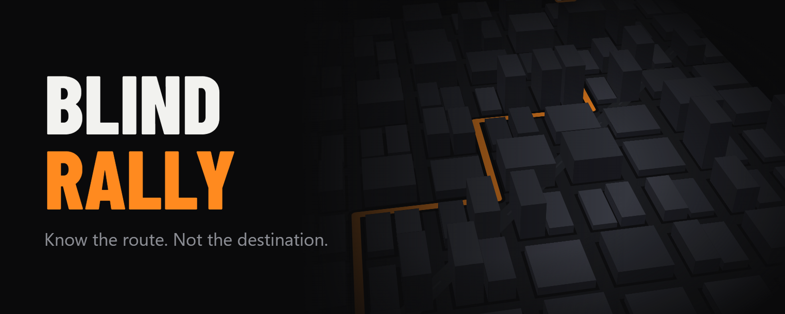
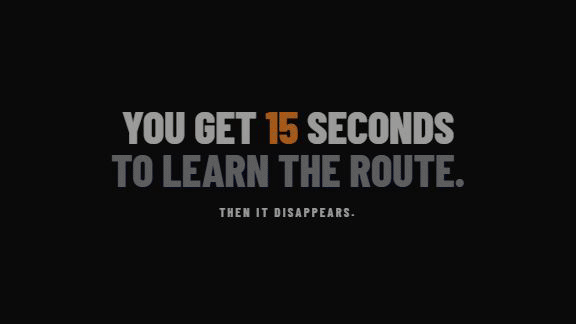

<div align="center">



# Blind Rally

**Know the route. Not the destination.**

A real-world navigation game for your phone. Memorize a route on a 3D map in 15 seconds,<br>
then find a hidden destination from memory, against the clock.

[](https://theagencymge.github.io/blind-rally/)
[](docs/blind-rally-demo.mp4)

[](https://github.com/TheAgencyMGE/blind-rally/actions/workflows/pages.yml)
[](LICENSE)


<a href="docs/blind-rally-demo.mp4"></a>

</div>

---

## How it plays

| | |
|---|---|
| **1. Start where you stand** | Your GPS position is the start line. Pick walking or driving, a briefing time and a max distance. |
| **2. Memorize** | A tilted 3D map shows the route, the turns and the street names. You get **60 s** (Rookie), **30 s** (Pro) or **15 s** (Insane). |
| **3. It's gone** | The map, the line and the directions vanish. The stage clock starts. |
| **4. Find it** | Navigate from memory. Stop at the destination and GPS confirms you've arrived. Tap ⚑ to check in. |
| **5. Discover** | Only now do you learn where you were going: its name, a photo and your time against your personal best. |

The destination can be **a place** (a monument, museum, fountain or pier), **an area** (a park, plaza or neighbourhood), **a road** (a pedestrian street or scenic drive) or **something scenic** (a viewpoint, beach, waterfall or summit). It is never named until you arrive, not even in the directions or the map labels.

> [!IMPORTANT]
> **Driving mode is for passengers.** The game won't start until you confirm that a passenger holds the phone. The driver drives, and the navigator remembers.

## Features

- **🗺️ 3D briefing map**: dark vector tiles with extruded buildings, rotated so your route runs up the screen.
- **🧭 Real, reachable destinations**: public places from OpenStreetMap, routed and checked for walk or car access, with private, restricted and unroutable spots filtered out.
- **📍 Honest arrival detection**: arrival is gated on GPS accuracy, and you must stay in the zone for a few seconds at low speed, so driving past doesn't count.
- **⏱️ Refresh-proof timer**: the clock is based on timestamps, so a reload drops you straight back into the rally with the clock still running.
- **🏁 Personal bests** for each mode and difficulty, plus history and stats, all stored on your device.
- **📱 Installable PWA**: safe-area aware, offline app shell, and the screen stays awake during a rally.
- **🔒 Private by design**: no accounts, analytics, cookies or background tracking.
- **🆓 $0 to run**: static files, with no API keys and no backend.

## Play

**→ [theagencymge.github.io/blind-rally](https://theagencymge.github.io/blind-rally/)**

Open it on your phone, allow location, and tap **Start**. Add it to your home screen to use it like an app.

## Run locally

Requires Node 22+. The app has **no npm dependencies**.

```bash
git clone https://github.com/TheAgencyMGE/blind-rally.git
cd blind-rally
npm run dev          # http://localhost:8788
npm test             # 73 tests, node:test
```

**Testing on a desktop:** open `http://localhost:8788/?dev=1`. This swaps GPS for a simulator and adds Step / Arrive / Weak GPS buttons during the rally. Use `?dev=1&at=48.8584,2.2945` to start anywhere. Dev-mode results are never saved.

**Testing on a phone:** browsers only allow geolocation over HTTPS, so use a tunnel, for example `npx cloudflared tunnel --url http://localhost:8788`.

## Deploy your own

Everything that ships is in `public/`, and every path in it is relative, so it can be served from any subpath.

- **GitHub Pages:** fork the repo, then go to *Settings → Pages → Source: GitHub Actions*. [`pages.yml`](.github/workflows/pages.yml) runs the tests and deploys on every push to `main`.
- **Cloudflare Pages:** Framework *None*, no build command, output directory `public`. [`public/_headers`](public/_headers) adds a strict CSP and caching rules.
- **Anything else** that serves static files: upload `public/`.

## How it works

```
public/
  index.html            every screen; one visible at a time via body[data-screen]
  js/app.js             UI controller: state machine ↔ DOM ↔ GPS ↔ maps
  js/state.js           explicit game state machine (illegal transitions throw)
  js/rally.js           destination pipeline: places → rank → route → validate
  js/destinations.js    Overpass query/parse, Wikipedia fallback, weighted ranking
  js/routing.js         OSRM parsing and turn instructions
  js/arrival.js         accuracy-gated, dwell-based arrival detection + odometer
  js/timer.js           timestamp timers that survive backgrounding and reloads
  js/storage.js         settings, stats, PBs, scrambled in-progress rally
  js/map.js             MapLibre GL 3D map, buildings, route, label hiding
  js/config.js          every tunable: radii, arrival zones, endpoints, limits
video/                  Remotion source for the demo video
tests/                  node:test suites
```

<details>
<summary><b>Destination selection</b></summary>

1. One Overpass query fetches named public features in range: places, areas, pedestrian streets and `scenic=yes` roads, and natural spots. Anything tagged `access=private`, disused, military, or a small plaque is dropped. Fuel stations, banks and shops are kept as landmarks for the directions only.
2. If Overpass is busy, places come from Wikipedia geosearch instead, with administrative areas, hotels, offices, schools and bars filtered out.
3. Candidates must be between 35% and 100% of your radius in a straight line and not recently visited. They're ordered by weighted random choice, so a viewpoint beats a café.
4. Up to 6 candidates are routed with OSRM. A candidate is rejected if it can't be reached, if it's too far off a walkable or drivable way, if the route detours more than 2.2× the radius, or if it has more than 22 maneuvers (an unmemorable maze).
5. The arrival zone covers both the feature and the point where the route ends, since a park's centre can be far from its entrance.
6. The destination's name is scrubbed from the directions and the map labels.

</details>

<details>
<summary><b>Game integrity & privacy</b></summary>

- When the briefing ends, the map instance is destroyed, the directions DOM is cleared, and the route is deleted from memory and storage.
- The in-progress rally is lightly scrambled in localStorage so a refresh can resume it. This keeps spoilers out of DevTools at a glance; it is not security.
- GPS is only watched while the page is visible. The track is never stored, only a running distance total.
- Manual confirmation is available when GPS fails. It counts as completed but never toward best times.
- Full details are in the [privacy policy](https://theagencymge.github.io/blind-rally/privacy.html).

</details>

## Third-party services

All free and keyless. Please respect their usage policies.

| Service | Used for | Notes |
|---|---|---|
| [OpenFreeMap](https://openfreemap.org) | 3D vector tiles | Free, no key |
| [Overpass API](https://wiki.openstreetmap.org/wiki/Overpass_API) | Finding places | One query per rally, cached in memory |
| [Wikipedia geosearch](https://www.mediawiki.org/wiki/API:Geosearch) | Fallback places | Used only when Overpass is unavailable |
| [OSRM on FOSSGIS](https://routing.openstreetmap.de) | Walking and driving routes | Requests spaced ≥1.1 s apart, at most 6 per rally |
| [OSRM demo](https://github.com/Project-OSRM/osrm-backend/wiki/Demo-server) | Driving fallback | Demo server, low volume |
| Wikidata / Wikimedia Commons | Photo on arrival | Credited and linked |

These are shared community resources. If Blind Rally gets real traffic, run your own OSRM and Overpass (both have Docker images) and point [`config.js`](public/js/config.js) at them.

## Demo video

The demo is made in code with [Remotion](https://remotion.dev). The 3D city is CSS 3D, not footage.

```bash
cd video && npm install
npm run studio       # live preview
npm run render       # → out/blind-rally-demo.mp4
```

## Contributing

Issues and PRs are welcome. Please keep it lightweight: no build step, no runtime dependencies, and nothing that pulls focus from the core game. Run `npm test` before opening a PR.

## License

[MIT](LICENSE) © Blind Rally contributors. Map data © [OpenStreetMap](https://www.openstreetmap.org/copyright) contributors.
Bundled: MapLibre GL JS (BSD-3-Clause) and Barlow Condensed (SIL OFL 1.1).
